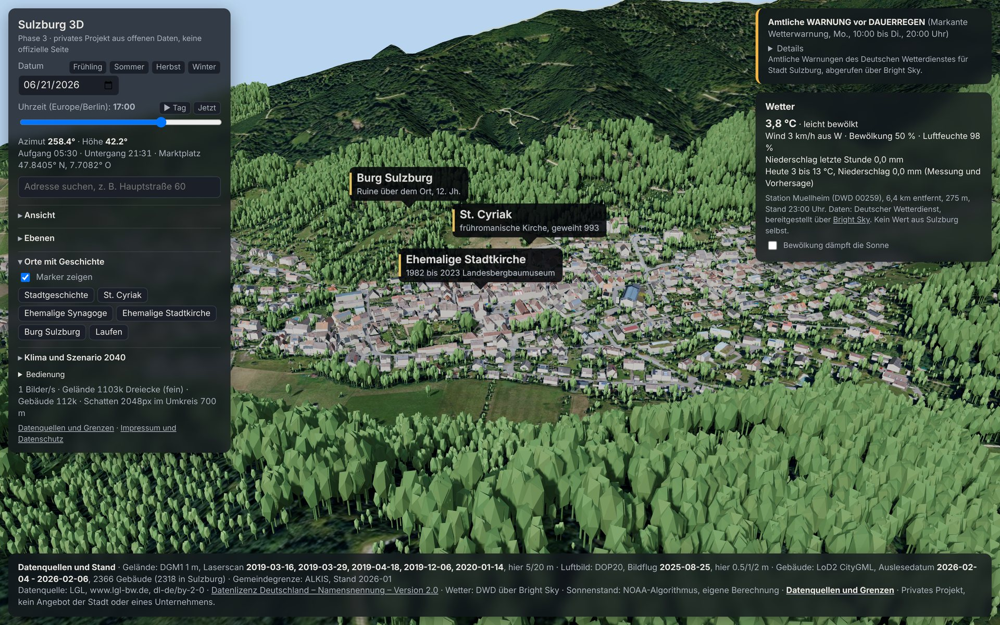
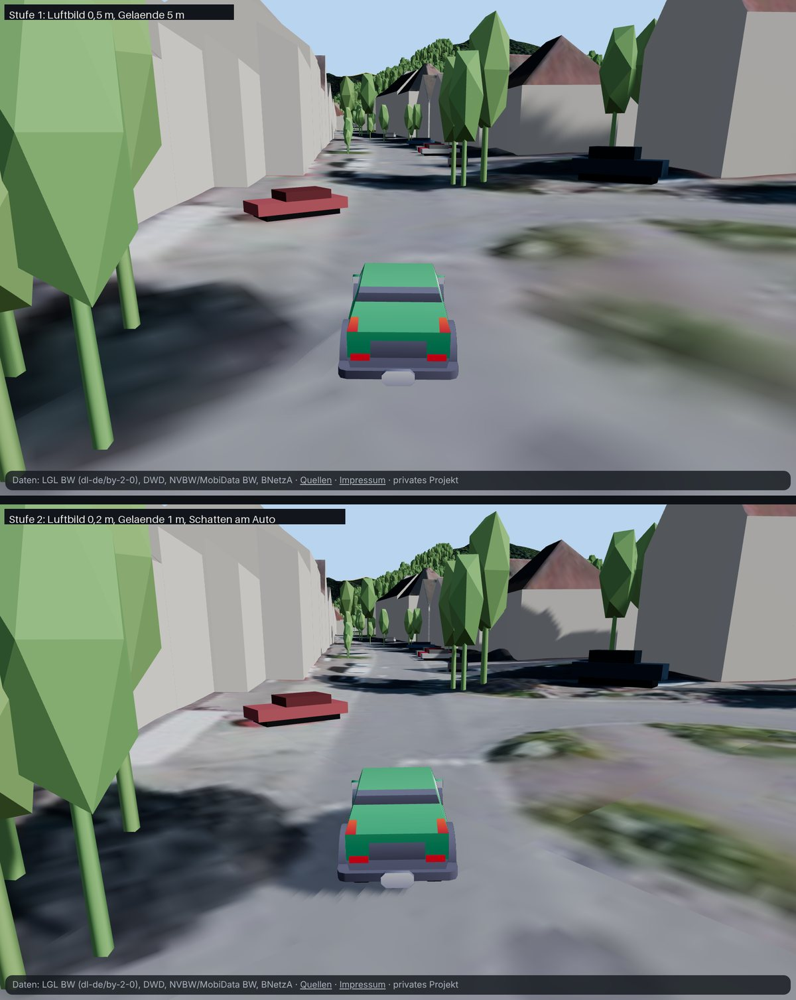
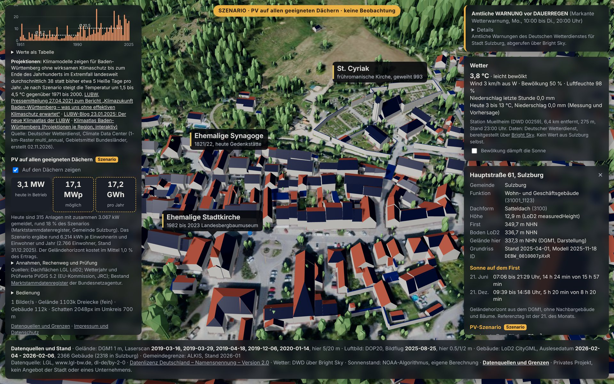
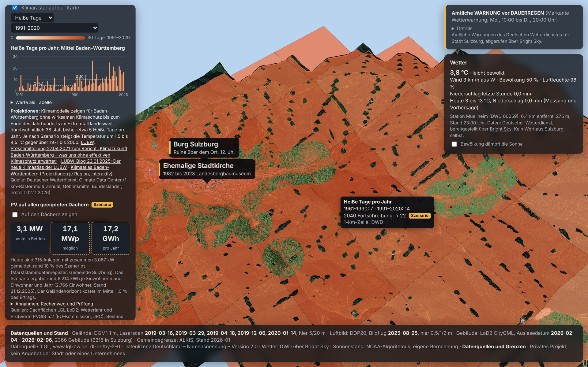
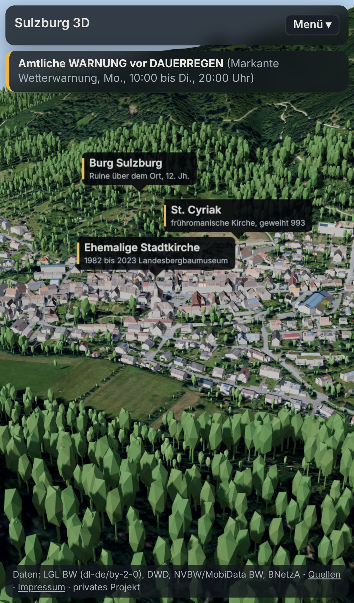

# Sulzburg 3D

Privater Prototyp: die Gemeinde Sulzburg (Landkreis Breisgau-Hochschwarzwald) als begehbares 3D-Modell im Browser, gebaut aus offenen Daten des Landes Baden-Württemberg, des Deutschen Wetterdienstes, der Bundesnetzagentur und der EU-Kommission. Kein Angebot der Stadt Sulzburg und keines Unternehmens. Kein Wappen, kein Logo.

Live: https://floriandavidzeiser.github.io/sulzburg-3d/



## Was das Modell zeigt

**Das Tal (Phase 1)**
- Gelände der ganzen Gemeinde plus 250 m Rand aus dem Höhenmodell DGM1, 147 Kacheln, 5 m Raster im Siedlungsbereich, 20 m sonst
- Luftbild DOP20 auf dem Gelände und auf den Dächern (Dachtextur je Gebäude aus dem Luftbild)
- Alle 2.318 Gebäude der Gemeinde als LoD2-Modelle mit echten Dachformen, dazu 48 Gebäude von Nachbargemeinden im Randbereich
- 66.580 Bäume aus dem Oberflächenmodell nDOM1: Lage und Höhe echt, Form generisch
- Amtliche Gemeindegrenze, Sonnenstand mit Schatten, Tagesablauf zum Abspielen
- Wetter jetzt und heute von der nächsten DWD-Station
- Klick auf ein Gebäude: Adresse, Funktion, Dachform, Höhen, Sonne auf dem First, PV-Abschätzung, Links zu Street View und Mapillary
- Adresssuche mit Kameraflug, Sprungziele, Einstiegsfahrt ins Tal

**Nützlich (Phase 2)**
- Sonne auf dem Dach: Geländehorizont je Gebäude, erste und letzte Minute direkter Sonne am 21. jedes Monats, Einfärbung aller Dächer
- Bus: elf Haltesteige der Linien 620, 640, 641 mit Abfahrten laut Soll-Fahrplan; Busse fahren nach Fahrplan entlang der Linienverläufe
- Amtliche DWD-Warnungen für die Warnzelle Stadt Sulzburg

**Zeitachse und Zukunft (Phase 3)**
- Sechs Orte mit Geschichte (Stadtgeschichte, St. Cyriak, ehemalige Synagoge, ehemalige Stadtkirche, Burg, Laufen) mit Fakten und Quellen
- Klima: Heiße Tage, Sommertage, Frosttage aus dem 1-km-Raster des DWD für 1961–1990 und 1991–2020, Jahresreihe Baden-Württemberg seit 1951, Fortschreibung 2040 ausdrücklich als Szenario
- Szenario „PV auf allen geeigneten Dächern“: 17,1 MWp und rund 17,2 GWh pro Jahr, gegenüber 3,1 MW heute laut Marktstammdatenregister

**Arbeiten und Wirtschaft (Variante A laut Konzept)**
- 29 Betriebe aus OpenStreetMap in drei Gruppen: Gewerbe, Handel, Dienste; Gastronomie und Übernachten; Wein und Gartenbau
- Je Betrieb Name, Branche, Adresse, Öffnungszeiten, Website, Barrierefreiheit; einzelne Fakten mit Quelle (Wikipedia)
- Solaranlagen laut Marktstammdatenregister nur bei ausdrücklich zugeordneten Betrieben (derzeit drei)
- Alle Betriebe gleich behandelt. Keine Umsätze, keine Mitarbeiterzahlen, keine Eigentümer oder Gesellschafter, keine Telefonnummern
- Hekatron nur mit Firmensitz, Branche, Adresse und Website. Keine Kennzahlen, keine Angaben zu Anlagen, Zugängen oder Barrierefreiheit am Standort. Regeln in `data/betriebe_kuratiert.json`
- Suche findet auch Betriebe; die Gebäude-Info nennt die Betriebe im Gebäude

**Parkende Autos und Bodenrichtwerte**
- 308 parkende Autos als 3D-Modelle, an den Stellen, an denen sie beim Bildflug am 25.08.2025 standen. Erkannt aus dem Oberflächenmodell nDOM1 und dem Luftbild, nur an Straßen und Parkplätzen aus OpenStreetMap; Farbe aus dem Luftbild, Höhe aus dem nDOM. Sichtprüfung von 48 Treffern: etwa 8 von 10 sind Autos; am Marktplatz rund 18 von gut 40 gefunden. Stichprobe in `docs/autos_stichprobe.jpg`
- Bodenrichtwerte: keine Ebene. Die Werte in BORIS-BW sind laut Nutzungsbedingungen urheberrechtlich geschützt, ihre Veröffentlichung ist untersagt. Die Gebäude-Info verweist stattdessen auf das amtliche Portal

**Fahren (Spielmodus, Stufe 1 und 2)**
- Auto aus dem Bedienfeld auf eine Straße ziehen oder an der Bildmitte absetzen; fahren mit W A S D oder Pfeiltasten, Leertaste Handbremse, C wechselt zwischen Verfolger- und Fahrersicht, L schaltet die Spurhilfe, R setzt auf die Straße zurück, Esc fliegt zurück zur vorherigen Ansicht. Auf dem Handy links ein Lenkbalken, rechts Gas und Bremse
- Befahrbar sind nur Straßen und Wege, die laut OpenStreetMap für Autos offen sind. Private Wege, reine Land- und Forstwege, Grundstückszufahrten und Erschließungswege auf Gewerbe- und Industrieflächen sind gesperrt, Betriebsgelände damit auch
- Kollision mit den LoD2-Grundrissen und den erkannten parkenden Autos; Brücken aus dem LoD2-Modell sind Fahrbahn
- Anzeige mit Tempo, Straßenname und Tempolimit laut OSM, Kennzeichnung „Spielmodus, kein echter Verkehr“
- Stufe 2: Rund um das Auto Fahrkacheln mit Gelände im 1-m-Raster (DGM1) und Luftbild in Originalauflösung 0,2 m (DOP20), nur an Straßen und Parkplätzen. An Gewerbe- und Industrieflächen bleibt das normale Luftbild, auch am Hekatron-Standort. Bäume und parkende Autos stehen dort auf der feinen Höhe
- Stufe 2: schärfere Schatten vor dem Auto, Spurhilfe (folgt der Straße rechts der Mitte, aus, sobald man selbst lenkt), Automodell aus dem Kenney Car Kit (CC0), Scheinwerfer bei Dunkelheit, Qualitätsstufe, die bei niedriger Bildrate selbst herunterschaltet (`?fq=0|1|2` setzt sie fest)
- Eigene Module (`web/drive.js`, `web/drive_tiles.js`), die erst beim ersten Absetzen laden (rund 0,2 MB übertragen), die Fahrkacheln dann nur rund um das Auto (rund 1 MB für die Umgebung). Beim Aussteigen kommt alles zurück: Kamera, Schatten, Geländematerial, Bäume, parkende Autos. Ohne Fahren bleibt die Anwendung wie vorher; `?drive=0` blendet den Modus ganz aus



**Feinschliff (Phase 4)**
- Seite „Datenquellen und Grenzen“ (`web/quellen.html`), erzeugt aus den Metadaten der Pipeline
- Impressum und Datenschutz als Vorlage (`web/impressum.html`), **Platzhalter vor öffentlicher Verbreitung ausfüllen**
- Handy-Ansicht mit einklappbarem Menü, Schließen-Knopf, kompakter Quellenzeile

| Szenario PV | Klimaraster | Handy |
|---|---|---|
|  |  |  |

## Starten

Statische Dateien, kein Build, kein Schlüssel.

```bash
cd web
python3 -m http.server 8123
# http://localhost:8123/
```

URL-Parameter: `?t=2026-06-21T18:30` (lokale Zeit), `&cam=-60,70,140` (Kamera relativ zum Marktplatz: Ost, Höhe, Süd), `&target=0,0`, `&lod=2` (Gelände grob), `&shadow=4096`, `&intro=0` (ohne Einstiegsfahrt).

Bedienung: Ziehen dreht, rechte Maustaste oder zwei Finger verschieben, Rad zoomt zur Mausposition, Doppelklick setzt den Blickpunkt, Pfeiltasten oder W A S D fahren, Q und E senken und heben.

## Struktur

```
scripts/   Datenpipeline (Python), Reihenfolge siehe unten
  common.py          Mittelpunkt, Pfade, Lizenz, Kachelliste, Annahmen des PV-Szenarios
  00_gemeinde.py     Gemeindegrenze und Gemarkungen (ALKIS), Liste der 2-km-Kacheln
  01_download.py     LGL-Kacheln laden (DGM1, LoD2, DOP20, nDOM1), Prüfsummen, Server-Datum
  02_terrain.py      Gelände gekachelt, zwei Auflösungen
  03_orthophoto.py   Luftbild je Geländekachel
  04_buildings.py    LoD2 -> GLB mit Dachtextur-Atlas, Dachflächen-Kennwerte, PV-Eignung je Fläche
  05_validate.py     Gebäude gegen Gelände, Adressen gegen OSM, Sonne, Ladevolumen, Ebenen -> docs/validierung.md
  06_sunlight.py     Geländehorizont je Gebäude, Sonne am First je Monat
  07_transit.py      Haltestellen, Soll-Abfahrten, Fahrten mit Linienverlauf (GTFS)
  08_trees.py        Bäume aus dem nDOM1
  09_places.py       Orte mit Geschichte (data/orte.json) prüfen und aufbereiten
  10_solar.py        PV-Szenario (PVGIS-Wetterjahr, Geländehorizont), Bestand aus dem MaStR
  11_climate.py      DWD-Klimaraster, Gebietsmittel BW, Fortschreibung 2040
  12_business.py     Betriebe aus OSM, Ergänzungen, Solar laut MaStR (Variante A)
  13_cars.py         Parkende Autos aus nDOM1 und DOP20 (Momentaufnahme Bildflug)
  14_drive.py        Fahrnetz aus OSM und Gebäudegrundrisse aus LoD2 für den Fahrmodus
  15_drive_tiles.py  Fahrkacheln: Gelände 1 m und Luftbild 0,2 m entlang der Straßen
  test_drive.cjs     Browsertest des Fahrmodus (Playwright) -> docs/fahrmodus_test.json
data/
  sources.json       Protokoll aller Downloads und Ebenen (URL, SHA-256, Stand, Kennzahlen, Validierung)
  orte.json          kuratierte Orte mit Fakten und Quellen (hier ergänzen oder kürzen)
  betriebe_kuratiert.json  Regeln und Ergänzungen der Wirtschaftsebene (Zusammenfassungen, Fakten, MaStR-Zuordnung, Hekatron-Regel)
  gemeinde.geojson, kacheln.json, codelisten/
  raw/, processed/   Rohdaten und Zwischenstände (nicht im Git, rund 5 GB, per Skript neu ladbar)
web/
  index.html, app.js, places.js, scenario.js, extras.js, business.js, cars.js, sun.js, style.css
  drive.js, drive_tiles.js  Fahrmodus, wird erst bei Nutzung geladen
  vendor/kenney-car-kit/    Automodell (CC0) mit Lizenztext und Herkunft
  quellen.html, quellen.js, impressum.html
  data/              aufbereitete Daten (22 MB, übertragen dank gzip rund 16 MB)
  vendor/three/      three.js 0.187.0 (MIT)
docs/                Screenshots, Validierungsbericht
.github/workflows/   Veröffentlichung von web/ über GitHub Pages
```

## Datenquellen, Lizenzen, Datenstände

| Ebene | Quelle | Lizenz | Datenstand |
|---|---|---|---|
| Gelände | LGL, DGM1 (1 m) | dl-de/by-2-0 | Laserscan 03/2019 bis 01/2020 |
| Luftbild, Dachtexturen | LGL, DOP20 RGB (TrueDOP) | dl-de/by-2-0 | Bildflug 25.08.2025 |
| Gebäude | LGL, LoD2 CityGML | dl-de/by-2-0 | Auslesedatum Februar 2026, Grundrisse 2025 |
| Bäume | LGL, nDOM1 | dl-de/by-2-0 | Oberfläche 25.08.2025 |
| Gemeindegrenze, Gemarkungen | LGL, Verwaltungsgrenzen ALKIS | dl-de/by-2-0 | Januar 2026 |
| Code-Bezeichnungen | AdV-Codelisten Dachform und Gebäudefunktion | AdV | Stand der Dateien |
| Wetter, Warnungen | Deutscher Wetterdienst über [Bright Sky](https://brightsky.dev) | DWD-Daten frei mit Quellenangabe | live |
| Klima | DWD Climate Data Center: 1-km-Raster multi_annual, Gebietsmittel Bundesländer | DWD-Daten frei mit Quellenangabe | 1961–1990, 1991–2020; Reihe bis 2025 (erstellt 02.11.2026) |
| Klimaprojektion (Text) | LUBW: Pressemitteilung 27.04.2021, Klimaatlas-Blog 23.01.2025 | Verweis | wie angegeben |
| Fahrplan | NVBW über MobiData BW, Soll-Fahrplandaten BW ohne Linienverlauf (GTFS) | dl-de/by-2-0 | Version 07.11.2026 |
| Linienverläufe | NVBW über MobiData BW, Soll-Fahrplandaten BW mit Linienverlauf | **ODbL** | Version 02.11.2026 |
| PV-Wetterjahr, Prüfwerte | PVGIS 5.2, EU-Kommission (JRC) | frei mit Quellenangabe | SARAH2 2005–2020 |
| PV-Bestand | Marktstammdatenregister, Bundesnetzagentur | dl-de/by-2-0 | abgerufen 08.11.2026, nur Summen |
| Orte mit Geschichte | Wikipedia-Artikel (Sulzburg, St. Cyriak, Synagoge, Burg Sulzburg, Laufen), bpb, Gemeinderatsvorlage 2023 | CC BY-SA 4.0 bzw. Verweis | abgerufen 08.11.2026 |
| Einwohnerzahl | Wikipedia (Infobox) | CC BY-SA 4.0 | 31.12.2025 |
| Marktplatz-Koordinate, Adress-Stichprobe | OpenStreetMap über Nominatim | ODbL | 08.11.2026 |
| Betriebe | OpenStreetMap über Overpass | ODbL | 09.11.2026 |
| Solaranlagen von Betrieben | Marktstammdatenregister, Bundesnetzagentur | dl-de/by-2-0 | abgerufen 09.11.2026 |
| Parkende Autos | abgeleitet aus LGL nDOM1 und DOP20, Straßen aus OpenStreetMap | dl-de/by-2-0, ODbL | Bildflug 25.08.2025 |
| Bodenrichtwerte | nur Verweis auf BORIS-BW, keine Übernahme | Veröffentlichung laut Nutzungsbedingungen untersagt | |
| Fahrnetz (Spielmodus) | OpenStreetMap über Overpass: Straßen, Parkplätze, Gewerbe- und Industrieflächen | ODbL | Straßen 09.11.2026, Flächen 01.06.2026 |
| Grundrisse (Spielmodus) | LGL LoD2, Bodenflächen | dl-de/by-2-0 | wie Gebäude |
| Fahrkacheln (Spielmodus) | LGL DGM1 und DOP20 in Originalauflösung | dl-de/by-2-0 | wie Gelände und Luftbild |
| Automodell (Spielmodus) | Kenney Car Kit 3.1, über OpenGameArt | CC0 | 02.04.2026 |
| 3D-Darstellung | three.js 0.187.0 | MIT | |

Namensnennung LGL: **„Datenquelle: LGL, www.lgl-bw.de, dl-de/by-2-0“**. Namensnennung MaStR: „Marktstammdatenregister – © Bundesnetzagentur | dl-de/by-2-0“. Weil `web/data/transit.json` Linienverläufe, `web/data/business.json` Betriebe und `web/data/fahrnetz.json` Straßen aus ODbL-Datensätzen enthalten, stehen diese Dateien unter ODbL.

## Pipeline

```bash
pip install numpy pyproj shapely pyshp lxml pillow tifffile mapbox_earcut astral
curl -o data/raw/Verw-Grenzen_ALKIS.zip https://opengeodata.lgl-bw.de/data/vg/Verw-Grenzen_ALKIS.zip
python3 -I scripts/00_gemeinde.py
python3 -I scripts/01_download.py                    # DGM1, LoD2, DOP20 (rund 4 GB)
python3 -I scripts/01_download.py --products ndom1   # für die Bäume
python3 -I scripts/04_buildings.py                   # Gebäude zuerst (Siedlungsmaske, Dachflächen)
python3 -I scripts/02_terrain.py
python3 -I scripts/03_orthophoto.py
python3 -I scripts/06_sunlight.py
curl -o data/raw/bwgesamt.zip https://www.nvbw.de/fileadmin/user_upload/service/open_data/fahrplandaten_ohne_liniennetz/bwgesamt.zip
mkdir -p data/raw/gtfs_shapes && curl -o data/raw/gtfs_shapes/bwgesamt_mit_linienverlauf.zip https://www.nvbw.de/fileadmin/user_upload/service/open_data/fahrplandaten_mit_liniennetz/bwgesamt.zip
python3 -I scripts/07_transit.py
python3 -I scripts/08_trees.py
python3 -I scripts/09_places.py
python3 -I scripts/10_solar.py                       # ruft PVGIS und das MaStR ab
# DWD-Dateien siehe Kopf von scripts/11_climate.py, Ablage in data/raw/dwd/
python3 -I scripts/11_climate.py
python3 -I scripts/12_business.py --neu-laden          # ruft Overpass und das MaStR ab
# Straßen und Parkplätze aus OSM nach data/raw/osm/strassen_overpass.json (Abfrage im Kopf von scripts/13_cars.py)
python3 -I scripts/13_cars.py
# Gewerbe- und Industrieflächen aus OSM nach data/raw/osm/gewerbeflaechen_overpass.json (Abfrage im Kopf von scripts/14_drive.py)
python3 -I scripts/14_drive.py
python3 -I scripts/15_drive_tiles.py                 # rund 27 MB Fahrkacheln
# Browsertest Fahrmodus: in web/ "python3 -m http.server 8124" starten, dann
node scripts/test_drive.cjs
python3 -I scripts/05_validate.py
```

Der Fahrplan läuft im Modell nur bis zum Ende des exportierten Zeitraums (sechs Wochen ab Lauf von `07_transit.py`). Für einen dauerhaften Betrieb müsste dieser Schritt regelmäßig laufen, etwa per GitHub-Workflow.

## Validierung (Details in `docs/validierung.md`)

- **Gebäude gegen Gelände.** 18.786 Bodenpunkte aller 2.366 Gebäude. Kein Gebäude schwebt. Acht haben einzelne Ecken über dem Sockel: drei Turm-Bauteile auf Dächern und fünf Brücken.
- **Adressen gegen OpenStreetMap.** Stichprobe von 20 Wohngebäuden; die gefundenen Adressen liegen im Median rund 2 m vom LoD2-Grundriss entfernt, höchstens 7 m. Fehlende Treffer betreffen Hausnummern, die in OSM fehlen.
- **Orte.** St. Cyriak liegt 13 m neben dem LoD2-Gebäude mit Funktion Kirche, die Synagoge 8 m neben Gustav-Weil-Straße 18 (Adresse laut bpb).
- **Sonnenstand.** Auf- und Untergang weichen höchstens 0,8 Minuten von astral ab.
- **PV-Modell.** Kalibriert auf PVGIS für 35° Süd; 15° Süd liegt 3,6 % darüber, Ost und West 5 bis 6 %. Das Szenario ist eher eine obere Grenze.
- **Klima.** Heiße Tage am Marktplatz 7 → 14 (DWD-Raster), Landesmittel 4,7 → 10,5. Sulzburg liegt am Oberrhein erwartungsgemäß darüber.
- **Betriebe.** 20 von 29 Betrieben über die Adresse einem LoD2-Gebäude zugeordnet, die übrigen am OSM-Punkt. Im Marktstammdatenregister stehen zwei weitere Firmen ohne Lage (Plasticant Mobilo, Krone GmbH); sie fehlen in der Karte, bis Lage und Branche belegt sind.
- **Parkende Autos.** 308 erkannt; in einer Sichtprüfung von 48 zufälligen Treffern lagen etwa 8 von 10 auf einem Auto. Am Marktplatz wurden rund 18 von gut 40 sichtbaren Autos gefunden. Fehltreffer sind vor allem Gartenobjekte und Paletten, Lücken entstehen unter Bäumen, an Gebäuden und in engen Reihen.
- **Fahrmodus.** Browsertest `scripts/test_drive.cjs`, Protokoll `docs/fahrmodus_test.json`: Beim Start wird keine Datei des Fahrmodus geladen. Nach dem Aussteigen stehen Kamera und Blickpunkt exakt wie vorher, das Bild ist pixelgleich. Ein einfacher Autopilot fährt 80 Straßen und Wege ab (19 km): 77 ohne Hängenbleiben, nie außerhalb der Spur, nie in einer Wand. Die drei Hänger sind Datenkonflikte (erkanntes Auto mitten auf der Fahrbahn, OSM-Weg führt in oder dicht an ein Gebäude). Die Fahrphysik braucht rund 1 ms je gefahrener Sekunde.
- **Busse.** Alle 154 Fahrten im Umgriff einem Linienverlauf zugeordnet. Ein Abgleich mit der Fahrplanauskunft des Verbunds steht aus.
- **Ladevolumen.** Rund 25 MB auf der Platte, rund 16 MB übertragen (gzip). Bei 20 Mbit/s etwa 6 bis 7 Sekunden bis alles geladen ist, bedienbar früher.

## Ehrliche Einschätzung

Was gut läuft: Alle Ebenen stammen aus offenen Quellen mit Lizenz und Stand, Szenarien sind sichtbar gekennzeichnet, die Pipeline ist reproduzierbar, und die Anwendung braucht weder Server noch Schlüssel.

Was hakt oder offen ist:

- **Performance auf echter Hardware** ist nur für „grob“ gemessen (60 Bilder/s auf Thomas' Laptop). „Fein“ und die neuen Ebenen (66.580 Bäume, Busse, Klimaraster) sind nur im Software-Rendering getestet.
- **Schatten** nur im Umkreis von 700 m um den Blickpunkt; ferne Berge werfen keinen Schatten ins Tal.
- **Fahrmodus.** Bildrate nur im Software-Rendering geprüft, auf echter Hardware offen; die Qualitätsstufe schaltet bei niedriger Bildrate selbst herunter. Aus Straßenhöhe zeigen sich die Grenzen der Daten: Auch das 0,2-m-Luftbild bleibt direkt am Auto weich (ein Pixel ist 20 cm, nichts Schärferes ist offen verfügbar), Fassaden sind einfarbig, OSM-Achsen liegen 1 bis 3 m neben dem Luftbild. Am Rand der Fahrkacheln sieht man einen geraden Übergang zum gröberen Luftbild. Erkannte parkende Autos sind Hindernisse, auch die Fehltreffer. Das Automodell hat Spielzeug-Proportionen (große Räder). Die Fahrkacheln vergrößern das Repository um rund 27 MB.
- **Klimaprojektion** für Sulzburg selbst ist nicht eingebunden. Ortsgenaue Projektionen (Klimaatlas BW, GERICS-Klimaausblick) waren nicht als offener Download zu finden; die Fortschreibung ist nur ein Trend.
- **Energieatlas BW** (offizielles Solarpotenzial) ist nicht eingebunden; die eigene Rechnung ersetzt ihn, sollte aber an drei Dächern gegen den Energieatlas geprüft werden (Abnahmekriterium Phase 2).
- **Luftqualität** (Umweltbundesamt): Schnittstelle antwortete mit Serverfehler. **Termine:** bewusst zurückgestellt.
- **Historische Luftbilder** sind im offenen LGL-Portal nicht verfügbar; die Zeitachse „gestern“ besteht deshalb aus Orten mit Geschichte und Klimadaten.
- **Impressum** enthält Platzhalter. Die Seite ist bereits öffentlich erreichbar.
- Die Vorlage „Niedergörsdorf in 3D“ ist weiterhin nicht gefunden.

## Nächste Schritte

1. Impressum ausfüllen, Variante A oder B entscheiden.
2. Rundgang mit Ortskenntnis und Fehlerliste (Abnahme Phase 4).
3. Energieatlas-Abgleich an drei Dächern, Abfahrten gegen die Fahrplanauskunft prüfen.
4. Fahrplan automatisch aktualisieren (Workflow), Luftqualität erneut versuchen.
5. Betriebsliste mit Ortskenntnis prüfen und fehlende Betriebe in OpenStreetMap eintragen; danach `12_business.py --neu-laden`.
6. Optional: Zensus-2022-Gitter (Baualter, Heizungsart), kaskadierte Schatten, Hochwassergefahrenkarten der LUBW.
