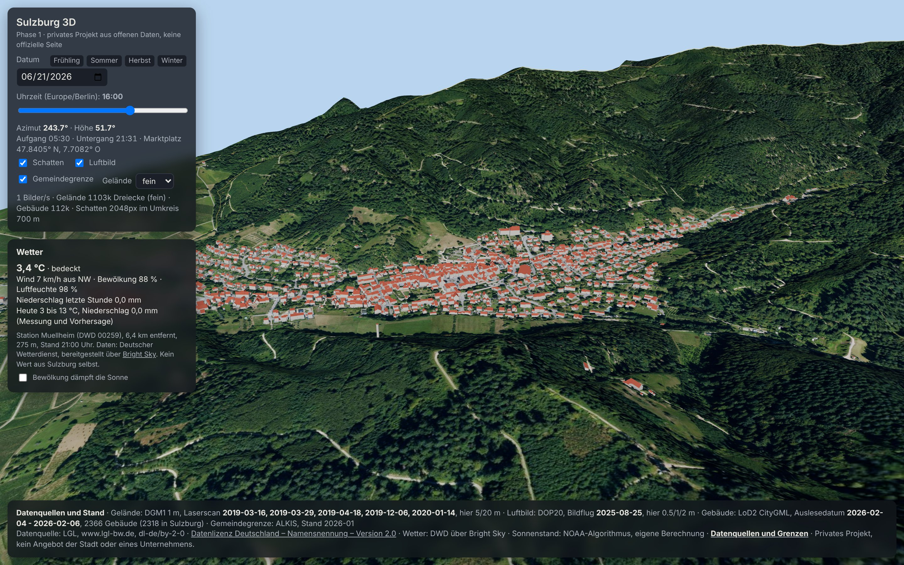

# Sulzburg 3D

Privater Prototyp: die Gemeinde Sulzburg (Landkreis Breisgau-Hochschwarzwald) als begehbares 3D-Modell im Browser, gebaut aus offenen Geodaten des Landes Baden-Württemberg und Wetterdaten des Deutschen Wetterdienstes. Kein Angebot der Stadt Sulzburg und keines Unternehmens. Kein Wappen, kein Logo.



## Stand: Phase 1 („Das Tal“)

- Gelände der ganzen Gemeinde plus 250 m Rand aus dem amtlichen Höhenmodell DGM1, gekachelt (147 Kacheln à 500 m, 5 m Raster im Siedlungsbereich, 20 m sonst)
- Luftbild DOP20 als Textur je Kachel (0,5 m im Ortskern, 1 m in Siedlungen, 2 m sonst)
- Alle 2.318 Gebäude der Gemeinde als LoD2-Modelle mit echten Dachformen, dazu 48 Gebäude von Nachbargemeinden im Randbereich
- Amtliche Gemeindegrenze (ALKIS) als Linie
- Sonnenstand für Datum und Uhrzeit mit Schattenwurf, Schnellwahl der Jahreszeiten
- Wetter jetzt und heute von der nächsten DWD-Station, abgerufen über Bright Sky
- Klick auf ein Gebäude: Adresse, Gemeinde, Gebäudefunktion, Dachform, Höhe, Boden- und Firsthöhe, Grundriss-Stand
- Seite „Datenquellen und Grenzen“ (`web/quellen.html`), erzeugt aus den Metadaten der Pipeline

Phase 0 (Spike mit 50 Gebäuden im Ortskern) ist in der Git-Historie erhalten; Screenshots davon liegen in `docs/screenshot.jpg` und `docs/screenshot-detail.jpg`.

## Starten

Statische Dateien, kein Build, kein Schlüssel. Ein lokaler Webserver ist nötig, weil der Browser Module und Binärdaten nicht aus dem Dateisystem lädt.

```bash
cd web
python3 -m http.server 8123
# http://localhost:8123/
```

URL-Parameter für reproduzierbare Ansichten: `?t=2026-06-21T18:30` (lokale Zeit), `&cam=-60,70,140` (Kamera relativ zum Marktplatz: Ost, Höhe, Süd), `&target=0,0` (Blickpunkt), `&lod=2` (Gelände grob), `&shadow=4096` (Schattenkarte).

Veröffentlichung: `.github/workflows/pages.yml` legt den Ordner `web/` auf GitHub Pages, sobald in den Repo-Einstellungen unter Pages die Quelle „GitHub Actions“ gewählt ist. Impressum und Datenschutz sind vor einer Veröffentlichung noch zu ergänzen (Phase 4).

## Struktur

```
scripts/   Datenpipeline (Python, reproduzierbar, läuft komplett in unter zwei Minuten plus Download)
  common.py          Mittelpunkt, Pfade, Lizenz, Kachelliste
  00_gemeinde.py     Gemeindegrenze aus den ALKIS-Verwaltungsgrenzen, Liste der 2-km-Kacheln
  01_download.py     LGL-Kacheln laden, Prüfsummen und Server-Datum protokollieren
  02_terrain.py      DGM1 (XYZ) -> web/data/terrain/heights.bin + index.json (gekachelt, zwei Auflösungen)
  03_orthophoto.py   DOP20 (TIFF + TFW) -> web/data/terrain/o_*.jpg je Kachel
  04_buildings.py    LoD2 (CityGML) -> web/data/buildings.glb + buildings.json (alle Gebäude, mit Sockel)
  05_validate.py     Gebäude gegen Gelände, Adressen gegen OpenStreetMap, Sonnenstand, Ladevolumen -> docs/validierung.md
data/
  sources.json       Protokoll aller Downloads und Ebenen (URL, SHA-256, Server-Datum, Kennzahlen, Validierung)
  gemeinde.geojson   amtliche Gemeindegrenze (EPSG:25832)
  kacheln.json       benötigte LGL-Kacheln mit Flächenanteil
  codelisten/        amtliche AdV-Codelisten (Dachform, Gebäudefunktion)
  raw/               Rohdaten des LGL (nicht im Git, rund 4 GB, per 01_download.py neu ladbar)
web/
  index.html, app.js, sun.js, style.css   Anwendung (three.js, ES-Module, kein Build)
  quellen.html, quellen.js                Seite „Datenquellen und Grenzen“
  data/              aufbereitete Daten (rund 17 MB)
  vendor/three/      three.js 0.187.0 (MIT), lokal eingebunden
docs/                Screenshots, Validierungsbericht
```

## Datenquellen, Lizenzen, Datenstände

Alle Geobasisdaten stammen vom Landesamt für Geoinformation und Landentwicklung Baden-Württemberg (LGL) über das [Open GeoData Portal](https://opengeodata.lgl-bw.de/). Lizenz: [Datenlizenz Deutschland – Namensnennung – Version 2.0](https://www.govdata.de/dl-de/by-2-0). Vorgeschriebene Namensnennung: **„Datenquelle: LGL, www.lgl-bw.de, dl-de/by-2-0“**. Koordinaten ETRS89/UTM 32N (EPSG:25832), Höhen NHN (DHHN2016). Downloads am 08.11.2026, Prüfsummen und Server-Daten in `data/sources.json`.

| Ebene | Produkt | Umfang | Datenstand (aus den Metadaten der Lieferung) |
|---|---|---|---|
| Gelände | DGM1, 1 m Raster, Höhengenauigkeit ±0,15 m | 16 Kacheln à 2 km, 64 Teilkacheln | Laserscan 16.03.2019 bis 14.01.2020, je nach Teilkachel |
| Luftbild | DOP20 RGB, TrueDOP, 20 cm, Kamera Leica DMC-4 | 16 Kacheln (3,7 GB Rohdaten) | Bildflug **25.08.2025** |
| Gebäude | LoD2, CityGML 1.0 | 2.366 Gebäude im Umgriff | Auslesedatum 04. bis 06.02.2026, Aktualität ALKIS LoD2 01.04.2025, Grundrisse Stand 2025, Modelle erstellt November bis Dezember 2025 |
| Gemeindegrenze | Verwaltungsgrenzen aus ALKIS, Ebene Gemeinde | Sulzburg, 22,73 km² | **Januar 2026** |

Weitere Quellen:

| Zweck | Quelle | Lizenz / Hinweis |
|---|---|---|
| Wetter jetzt und heute | Deutscher Wetterdienst, Open Data, abgerufen über [Bright Sky](https://brightsky.dev) (api.brightsky.dev, frei, ohne Schlüssel) | DWD-Daten frei nutzbar mit Quellenangabe; nächste Station meist Müllheim, 6,4 km |
| Bezeichnungen der Codes für Dachform und Gebäudefunktion | AdV-Codelisten `RoofTypeTypeAdV.xml`, `BuildingFunctionTypeAdV.xml` von repository.gdi-de.org | AdV, Kopie in `data/codelisten/` |
| Mittelpunkt des Modells (Marktplatz) und Adress-Stichprobe der Validierung | OpenStreetMap über Nominatim | © OpenStreetMap-Mitwirkende, ODbL. Keine Datenebene in der Anwendung |
| Sonnenstand | eigene Berechnung nach dem NOAA-Algorithmus (`web/sun.js`) | geprüft gegen die Python-Bibliothek astral |
| 3D-Darstellung | [three.js](https://threejs.org/) 0.187.0 | MIT, `web/vendor/three/LICENSE` |

## Pipeline nachvollziehen

```bash
pip install numpy pyproj shapely pyshp lxml pillow tifffile mapbox_earcut astral
curl -o data/raw/Verw-Grenzen_ALKIS.zip https://opengeodata.lgl-bw.de/data/vg/Verw-Grenzen_ALKIS.zip
python3 -I scripts/00_gemeinde.py       # Grenze und Kachelliste
python3 -I scripts/01_download.py       # 16 Kacheln DGM1, LoD2, DOP20 (rund 4 GB)
python3 -I scripts/04_buildings.py      # Gebäude zuerst, das Gelände braucht die Siedlungsmaske
python3 -I scripts/02_terrain.py
python3 -I scripts/03_orthophoto.py
python3 -I scripts/05_validate.py
```

## Validierung (Stand 08.11.2026, Details in `docs/validierung.md`)

**Gebäude gegen Gelände.** 18.786 Eckpunkte der Bodenflächen aller 2.366 Gebäude. Gegen das DGM1: Median −0,39 m, 72 % innerhalb ±1 m. Gegen das dargestellte, gröbere Gelände: 73 % innerhalb ±1 m, 0,7 % der Punkte liegen höher als der 2-m-Sockel reicht. **Kein Gebäude schwebt komplett.** Acht Gebäude haben einzelne Ecken über dem Sockel: drei Kirch- und Museumstürme (Bauteile, die auf Dächern sitzen) und fünf Brücken, die das LGL bewusst nicht ans Gelände zieht. Negative Werte sind gewollt: Das LGL setzt die Bodenfläche am tiefsten Geländepunkt an, am Hang stecken die Wände im Boden.

**Adressen gegen OpenStreetMap.** 20 zufällig gewählte Wohngebäude mit Hausnummer. 18 in OSM mit Hausnummer gefunden, Abstand zum LoD2-Grundrissmittel im Median 1,9 m, maximal 6,8 m. Zwei Hausnummern fehlen in OSM.

**Sonnenstand.** Auf- und Untergang weichen höchstens 0,8 Minuten von astral ab. Einschränkung: gleicher Algorithmus, geprüft wird die Umsetzung.

**Ladevolumen.** 19,3 MB insgesamt (Luftbild 9,0 MB, Gebäude 6,6 MB, Gelände 1,2 MB, three.js und Anwendung 1,4 MB). Bei 20 Mbit/s rund 8 Sekunden, bei 50 Mbit/s rund 3. Gelände und Gebäude kommen zuerst, Luftbildkacheln laden nach.

**Sichtprüfung.** Marktplatz, Stadtkirche, Rathaus, Landesbergbaumuseum, Laufen und St. Ilgen liegen im Luftbild dort, wo die Modelle stehen. Die dünnen hohen Objekte am Hang sind drei Funkmasten aus den ATKIS-Bauwerken (31 bis 53 m), keine Fehler.

## Ehrliche Einschätzung

Was gut läuft:

- Die amtlichen Daten passen ohne Korrektur zusammen: Gelände, Grenze, Gebäude und Adressen aus einer Quelle, eine Lizenz, 16 Kacheln per URL.
- Alles läuft ohne Dienst, Schlüssel oder Build. Wetter ist der einzige Live-Abruf, und der Ausfall wird angezeigt statt überspielt.
- Die Pipeline rechnet die ganze Gemeinde in unter zwei Minuten nach dem Download.

Was hakt oder offen ist:

- **Performance ist weiter nicht auf echter Hardware gemessen.** Hier gibt es nur Software-Rendering. Das feine Gelände hat 1,1 Mio. Dreiecke, die Gebäude 112.000. Auf kleinen Geräten startet die Anwendung automatisch grob (276.000 Dreiecke), der Schalter „Gelände“ wechselt jederzeit.
- **Schatten nur im Umkreis von 700 m um den Blickpunkt.** Die Berge im Osten werfen im Modell keinen Schatten ins Tal, solange man nicht dorthin blickt. Kaskadierte Schattenkarten wären der nächste Schritt.
- Höhenmodell 2019/2020 gegen Luftbild und Gebäude 2025: Neubaugebiete können sichtbar werden.
- Die Luftbildkacheln haben an den Kanten der Auflösungsstufen sichtbare Sprünge (0,5 m neben 2 m).
- Die Vorlage „Niedergörsdorf in 3D“ aus dem LinkedIn-Post ist weiterhin nicht gefunden.
- Die Gebäudeliste (`buildings.json`, 1 MB) trägt mehr Felder als die Klick-Info braucht; Quantisierung des GLB könnte das Ladevolumen um ein Drittel senken.

## Nächste Schritte (Phase 2 laut Konzept)

Solarpotenzial je Dach (Energieatlas BW, Nutzungsbedingungen prüfen), „Wann kommt die Sonne auf mein Dach?“ aus Gelände und Sonnenstand, Haltestellen und Abfahrten (MobiData BW, GTFS), Termine, Warnungen des DWD, Luftqualität des Umweltbundesamts. Vorher die offene Entscheidung Variante A (privat) oder B (mit Kommunikation).
